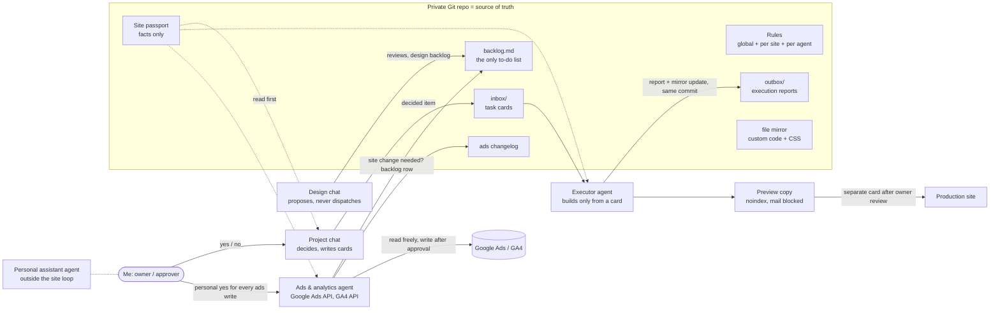

# AI Ops Case Study: running two client websites through a team of AI agents

> I'm a former data analyst. Today I run website administration, tracking and paid search for two small-business clients, and most of the hands-on work is done by AI agents I designed, briefed and govern. This repo is an anonymised write-up of that system: how it is wired, the rules that keep it safe, and what it has produced so far.

**Clients (anonymised):** Client A, a wellness centre (WordPress landing site plus Google Ads), and Client B, a multi-specialty medical clinic (WordPress site with about 200 URLs in two languages).
**Period covered:** first 12 days of the system in production (2026-10-01 to 2026-10-12).
**Status:** live and in daily use. Numbers come from the private working repo and read-only exports from the ad accounts. Missing numbers are marked `[TODO]`; nothing here is estimated.

---

## Why I built this

At first I used AI only as an information assistant. I ran the ads and made site edits by hand. Then a client site's hosting was hacked and the site was lost. I rebuilt it from old backups with AI help, and it came out cleaner and better than before. After that I moved all the work to AI agents and onboarded other sites in parallel. That history explains three things you'll see throughout this repo: strict security and access rules per agent, a **site passport** as the single source of truth, and backup-before-every-change as a default.

## TL;DR: key takeaways for reviewers

Every claim below links to the evidence for it in this repo. Numbers come from the private working repo (git history, card and report files, ads audit and changelog). Where a number isn't known yet, it's marked `[TODO]` instead of estimated.

1. **I design multi-agent systems, not just prompts.** I set up four roles with written boundaries: a decision agent (project chat), a proposal agent (design chat), an executor agent and a per-site ads & analytics agent, coordinated through task cards in Git. → [docs/architecture.md](docs/architecture.md), [templates/bot-rules.md](templates/bot-rules.md)
2. **It runs in production on live client sites.** In the first 12 days (2026-10-01 to 2026-10-12) it produced 249 commits, 62 task cards and 54 committed execution reports across 2 client websites. → [docs/evidence.md](docs/evidence.md#1-activity-from-git-history)
3. **I set up connectors directly and for free.** I built Google Ads API and GA4 Data/Admin API access on my own Google Cloud OAuth client (no billing, Explorer access tier), with secrets kept only on the agent machine. No paid connector service and no browser automation for routine work. → [docs/connectors.md](docs/connectors.md)
4. **I bring analyst rigour to marketing, including my own work.** I ran the client's Google Ads account myself from 04/2023: ≈172k (account currency) lifetime spend, 53,114 clicks, 1.02M impressions, CTR 5.20%. It ran **without working conversion tracking** (0 primary conversions ever). The API audit made that visible, traced it to measurement setup, and quantified the waste. In the 14 days before the fixes, Display took 27.5% of spend and 88% of impressions; over 90 days, ≈10% of spend went to irrelevant queries. → [docs/measurement-case.md](docs/measurement-case.md)
5. **Changes are governed and auditable.** Every ads write goes proposal → owner approval → `validate_only` → apply → re-read → changelog entry. A reviewed keyword-list mistake was caught and corrected the same minute. → [docs/evidence.md](docs/evidence.md#2-excerpt-from-the-ads-changelog), [docs/measurement-case.md](docs/measurement-case.md#what-was-changed-2026-10-12-all-approved-by-me)
6. **Agents deliver working code from task cards, verified with evidence.** The executor shipped WordPress mu-plugins for tracking, a preview-copy guard and spam-URL blocking, each with before/after checks in its report. → [examples/wordpress-mu-plugins/](examples/wordpress-mu-plugins/), [docs/workflow.md](docs/workflow.md)
7. **The pattern carries over to other domains.** The parts that make it work (source-of-truth files, task cards, role-scoped rules, approval gates, direct API connectors) are domain-neutral and come as templates. → [templates/](templates/)

What this repo does **not** claim: post-change performance (there are no full days of data after 2026-10-12 yet, so these stay `[TODO]`), recorded lead conversions (the tracking fix is built but not yet deployed), Meta Marketing API use in production (documented, not yet run), and production use of the tools I only trialled (see [Tools I use and why](#tools-i-use-and-why)).

## Capabilities matrix

| Capability | What I did | Evidence |
|---|---|---|
| Multi-agent architecture | 4 agent roles with an access matrix; one executor shared by all sites, ads agents per site | [architecture.md](docs/architecture.md#components) |
| Agent workspaces & memory | Private Git repo as shared memory; site passport as the single source of truth; rules written to files in the same turn they're decided | [architecture.md](docs/architecture.md#repository-layout-per-site), [site-passport.md](templates/site-passport.md) |
| Agent rules & guardrails | Profile texts with can / needs-approval / never sections; one card, one risk; stop conditions | [bot-rules.md](templates/bot-rules.md), [task-card.md](templates/task-card.md) |
| Task orchestration | Backlog → card → report lifecycle with statuses; one-line dispatch | [workflow.md](docs/workflow.md) |
| Connectors (direct, free) | Google Ads API + GA4 Data/Admin API via own OAuth desktop client; WordPress REST via application password; GitHub | [connectors.md](docs/connectors.md) |
| Paid search (Google Ads) | Ran the account since 04/2023 (≈172k account currency lifetime, 53k clicks); API audit; Display off; geo set to presence only; 51-term shared negative list | [measurement-case.md](docs/measurement-case.md), [evidence.md](docs/evidence.md#2-excerpt-from-the-ads-changelog) |
| Tracking & analytics | GA4 in a single gtag loader; Ads conversion and Meta `Lead` on the form-success event; preview-copy pitfall found by reading the plugin source | [measurement-case.md](docs/measurement-case.md#lead-measurement-shipped-vs-pending), [ads-conversion-tag.php](examples/wordpress-mu-plugins/ads-conversion-tag.php) |
| Technical SEO / site audit | 196-URL audit of a medical clinic site, with a staged fix plan | [evidence.md](docs/evidence.md#3-site-audit-client-b) |
| Web via code | mu-plugins, file mirror in Git, preview → production release path, one-file rollback | [examples/](examples/wordpress-mu-plugins/), [architecture.md](docs/architecture.md#release-path) |
| Data analysis background | ~3.5 years as a data and product analyst at mobile game companies: analytics set up from scratch per game, ETL, forecasts, A/B test analysis, decision support for marketers and producers | CV (separate document) |
| Tool selection | Main system on one agent platform with role-based bots; other agent tools trialled and compared per task | [Tools I use and why](#tools-i-use-and-why) |

Machine-readable summary: [profile.yaml](profile.yaml) · Index for LLM readers: [llms.txt](llms.txt)

---

## 1. What I built



Roles and boundaries:

- **Project chat (one per site), the decision maker.** Reads the passport, rules and backlog, then decides. It writes the task card and dispatches it to the executor, but only after my confirmation. It never logs in to a server itself.
- **Design chat, the proposer.** Writes dated design reviews (findings `F1…Fn`) and a design backlog (`D1…Dn`). It never writes cards and never talks to the executor.
- **Executor agent, one for all sites.** Its name carries no client name, so adding a site doesn't mean renaming it. It works *only* from a card path in the repo, reads only that site's passport, and must commit a report to `outbox/`. No report means the task isn't done.
- **Ads & analytics agent, one per site.** Talks to Google Ads and GA4 through its own API scripts. It reads and audits freely. Every write needs my personal approval and runs through `validate_only` first. It never edits the website; when a campaign needs a page or tag change, it adds a backlog row.
- **Personal assistant agent.** Separate from the site loop, with no access to site rules or cards.

Full detail: [docs/architecture.md](docs/architecture.md)

## 2. How the work flows

```
idea / finding ──► backlog.md row (open)
                   │ project chat + owner decide
                   ▼
                decided ──► task card in inbox/ (in-card)
                               │ one-line dispatch: "Execute card <path>"
                               ▼
                       executor works on the preview copy
                               │
                               ▼
                 report in outbox/ + mirrored files, same commit
                               │ owner reviews
                               ▼
                 done  (prod release = separate card)
```

Rules that made this reliable:

1. **One card, one risk.** Small edits to the same file go into one card. A new card is needed whenever a *boundary* changes: publishing, price, tracking tag, access, or someone else's file.
2. **The goal beats the step.** A card states a measurable goal (for example "header height 105 px at 1440 px"). If the named step doesn't reach it, the executor may adjust within the same file and must say what actually moved the result.
3. **Read the mirror, not memory.** Before a visual card, the decision chat reads the mirrored CSS and plugin files. It learned this the hard way: a later rule in the same file was silently overriding an earlier one.
4. **Cheapest path first.** File, REST API or mirror before any browser clicking, because browser sessions burn the weekly agent quota. A click needs a stated reason and my yes. Failed attempts are never blindly repeated.
5. **Unknown means unknown.** Agents write `unknown` and never fill gaps with guesses.
6. **Rules live in files.** Any new rule decided in any chat is written into the repo in the same turn. Chats can't see each other's history, so a rule kept only in one chat doesn't exist for the others.

Sample card, report and lifecycle: [docs/workflow.md](docs/workflow.md)

## 3. Source of truth: the site passport

Every site has one `site-passport.md` holding facts only: domain and renewal dates, hosting, CMS and theme, every custom file and why it exists, forms and where leads go, the measurement setup, what's unfinished, and **where each fact came from** (confirmed by the owner, live-checked on a date, or unknown). Secrets are never stored, only *where* they live.

Blank template: [templates/site-passport.md](templates/site-passport.md)

## 4. Connectors: direct and free

- **Google Ads API + GA4 Data/Admin API:** I created a Google Cloud project (no billing), an OAuth consent screen in testing mode with the account as a test user, and a Desktop OAuth client. Python scripts run in a venv on the agent's own machine. Tokens are stored there with `chmod 600` and never in the repo or chat. Explorer access was granted within minutes.
- **WordPress:** a dedicated non-admin editor user with an application password. REST and file transfer come before any UI clicking.
- **GitHub:** the private repo is the shared memory every agent reads.
- **Meta Marketing API:** setup steps are documented against the official docs but not yet run in production.

Why this route: no subscription, fewer tokens than browser automation, and access I can audit and revoke.
How-to without secrets: [docs/connectors.md](docs/connectors.md)

## 5. Results so far

**Operations (2026-10-01 to 2026-10-12):** 249 commits, 62 task cards, 54 committed reports across 2 sites.

**Client A (wellness centre): measurement & paid search** ([docs/measurement-case.md](docs/measurement-case.md))
- **Account history:** I ran the account myself from 04/2023 to 10/2026. Lifetime it had ≈172k (account currency) spend, 53,114 clicks, 1,021,269 impressions, CTR 5.20% and average CPC 3.24. Primary conversions recorded over that whole period: **0**. The campaigns ran without working conversion tracking, and I'm stating that plainly because the diagnosis is the point of this case.
- **Root cause:** 7 enabled *primary* conversion actions, 3 of them page-view types. The form-submit action never recorded a primary conversion. GA4 (live since 2026-10-01) shows 284 sessions, 51% of them paid search, and **0 key events**, with no `generate_lead` event at all.
- **Waste found:** in the 14 days before the fixes (account CTR 1.47%, CPC 21.63, 194 clicks), Display inside a Search campaign took 27.5% of spend, 51% of clicks and 88% of impressions. Over that campaign's lifetime, Display CTR was 1.36% against 6.08% on Search. Over 90 days, ≈10% of spend went to competitors, other cities, training courses and job seekers (broad match, no negatives). Targeting was "presence or interest", so clicks came from outside the service area.
- **Applied after approval (2026-10-12, via API):** Display off, presence-only geo on 3 campaigns, and a shared negative list (52 terms, then corrected to 51 when a review caught the client's own specialist's surname).
- **Lead-tracking fix prepared, pending deploy:** form, `tel:` and messenger events as primary conversions, page views demoted to secondary, GA4 `generate_lead` as a key event.
- **Already shipped:** GA4 added to the existing tag block without a second loader, verified in production HTML. Meta Pixel `PageView` + `Lead` runs on the preview copy only, behind a host guard. The existing Ads form-success tag has recorded just 1 submission, in October 2026, counted under "all conversions" and not as a primary conversion.
- **A non-obvious finding:** on the preview copy, mail is suppressed but the form plugin still reports success, so test submissions *would* send real `Lead` conversions. That's now a documented rule.
- **After:** `[TODO: CTR / CPC / Display share / irrelevant-query share, 14 and 30 days after 2026-10-12]` · `[TODO: primary conversions after the lead-tracking deploy]`

**Client A: site**
- A preview environment with a guard plugin (noindex, robots disallow, all outgoing mail and notifications blocked).
- Privacy policy published, then terms of use and an English legal version added on the preview copy.
- Junk spam URLs that returned the full homepage with 200 now return 403, while UTM and click-ID links are verified to still return 200.

**Client B (medical clinic): audit before touching anything**
- Public crawl of 196 sitemap URLs (all 200), then a read-only admin inventory.
- Findings: homepage without H1 or meta description, titles in the wrong language on the primary-language pages, 6 of 11 homepage images without alt text, no SEO plugin, three overlapping content layers (old pages, taxonomy and landing pages), two competing doctor directories, a public user sitemap and author archive, no recent backup, and no legal entity or licence shown on the site.
- The output is a staged fix plan with explicit "don't touch without owner sign-off" boundaries (prices, packages, third-party booking integration).
- `[TODO: indexed pages / Search Console clicks before and after fixes]`

## 6. What I'd do next

1. **Close the lead-tracking gap end to end:** form, `tel:` and messenger clicks as primary conversions, page views demoted to secondary, internal traffic excluded. Until conversions flow, the audit proposes "Maximise clicks" with a CPC cap. Once the data supports it, go back to conversion-based bidding.
2. **An ad-copy variant agent:** generate RSA headline and description variants within compliance rules (for health services: no diagnosis or outcome promises), create them *paused*, and run structured A/B reads with a pre-registered decision rule.
3. **A weekly insight digest:** Ads + GA4 (+ CRM when available) pulled by API into a short "here's what changed and what to do next" note, committed to the repo.
4. **Make onboarding a template:** a new site becomes a new folder with a passport, rules and inbox/outbox. The executor stays the same agent; only the ads agent is per site.

## Tools I use and why

- **Main working system:** Grok Bot, running several role-based bots (project chats, the executor, a per-site ads & analytics bot, a personal assistant). Each one has its own profile rules and reads the same Git repo.
- **Trialled and compared, used per task:** Conductor (agent orchestrator), Claude Code, Codex and Gemini. I evaluated them against the same kind of tasks and picked the tool per task. None of them is a dependency of the system described here, and I don't claim sustained production use of them.
- **Everyday tools:** git/GitHub, Python (API scripts in venvs), Docker, Warp (terminal), Zed (editor).
- **Selection rule:** use the cheapest tool that reliably reaches the goal (API over browser, file over click), and keep the repo, not the tool, as the system of record, so tools can be swapped without losing memory.

## Repo map

```
README.md                    you are here
docs/architecture.md         roles, access matrix, boundaries
docs/workflow.md             backlog → card → report lifecycle, anonymised sample card + report
docs/connectors.md           direct API setup in general terms, pitfalls, no secrets
docs/measurement-case.md     the ads & tracking audit, anonymised
docs/evidence.md             activity numbers and how they were counted, changelog excerpt, site audit
profile.yaml                 machine-readable summary: role fit, skills, evidence paths
llms.txt                     index of key files for LLM readers
templates/                   agent rules, task card, report, site passport, backlog
examples/wordpress-mu-plugins/  generic, client-free code the executor shipped
```

*Anonymisation: client names, domains, account and tag IDs, hosts, contacts and security settings are removed or replaced with placeholders such as `{ADS_TAG_ID}`.*
