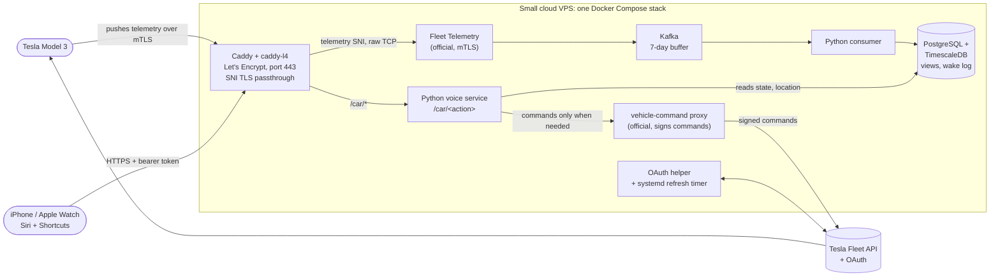

# Tesla Fleet: a self-hosted data and voice-control server for my own car

> A side project outside the client work in this repo. I built a self-hosted data collection and voice-control server for my own Tesla Model 3 in one day (2026-10-17), from idea to working voice commands, together with an AI agent. The car pushes its data to my server, everything lands in a time-series database, and I can control the car from Siri, Shortcuts and my Apple Watch. This page is an anonymised write-up; the sanitised code is in [code/](code/).

**Date:** 2026-10-17 (one day, idea to working voice commands)
**Author:** Roman Timoshenko · [GitHub](https://github.com/romantimesnew) · [LinkedIn](https://www.linkedin.com/in/timoshenkor/)
**Status:** running and in daily use. Visualisation is not built yet. There are no database backups yet (see [Security](#security)).

---

## What it is

A small cloud VPS runs one Docker Compose stack that talks to the car only through Tesla's official tools:

- the **Fleet API**, through my own registered partner app, with OAuth tokens refreshed automatically by a systemd timer;
- the **vehicle-command proxy**, which signs every command with my app key. The matching virtual key was added in the car itself;
- **Fleet Telemetry**, where the car pushes its data to my server over mutual TLS.

There is **no API polling, by design.** Polling the Fleet API costs money and keeps the car awake, so the car sends data when values change and the server only listens. I don't use TeslaMate or Grafana; I wanted the pipeline built on the official components, and I plan to add my own visualisation later.

## Architecture

Data path: **car → Caddy (port 443, SNI passthrough) → Fleet Telemetry → Kafka → Python consumer → TimescaleDB.** Caddy gets the Let's Encrypt certificates and, through the caddy-l4 plugin, looks at the TLS server name on port 443. Telemetry connections are passed through untouched to Fleet Telemetry, which does the mutual TLS itself; everything else is normal HTTPS. So the telemetry server and the website share one port. Kafka keeps messages for 7 days and the consumer commits only after the database commit, so a crash loses nothing.

A small Python HTTP service handles the iOS Shortcuts and Siri commands. It reads the car's state from the database first and only calls Tesla (through the signing proxy) when a command really has to reach the car.

## What it can do

**Data**
- All telemetry goes into TimescaleDB, with SQL views for the latest state of every field, per-minute aggregates (battery, range, speed, power, temperatures, charging, gear), the location track and a 24-hour ingest volume check.
- **Wake-up log.** Tesla doesn't say why the car woke up, so the server guesses. Each connect event is matched with the values the car sends on connect and labelled with a likely cause: doors or unlocking, key or phone nearby, Sentry, charging or a charge schedule, climate, software update, driving, or one of my own commands.
- **API-call log.** Every call the server makes to Tesla is logged (without tokens) and attached to nearby wake-ups, so I can prove the server itself isn't waking the car.
- **Nightly summary** that reads only the database and never wakes the car. (It runs on the server and is not part of the published code.)

**Voice control** through Siri, Shortcuts and Apple Watch
- Trunk, frunk, charge port, charging start/stop, climate on/off and temperature, max defrost, seat heat, lock/unlock, horn and lights.
- **Status** answers without waking the car: battery, range, lock state, climate, temperatures, charging, plus how far away the car is and in which direction ("The car is 140 meters away, to the west").
- **Parked-car marker in Apple Maps**, set from the car's last known location.
- **Geofence:** trunk, frunk and charge port open only if my iPhone is within **8 m** of the car. A far-away request is refused before anything is sent to Tesla, so it doesn't even wake the car.
- **Dry-run mode** that runs all checks and replies "Test only: would send …" without sending anything.

## Security

- **Only SSH and HTTPS are open.** A cloud firewall plus ufw allow port 22 and port 443 (port 80 is open only so Let's Encrypt can check the domain and HTTP can redirect to HTTPS). Docker bypasses ufw, so every internal service (database, proxy, OAuth helper, voice service) is bound to localhost and reachable only through Caddy.
- **SSH is key-only,** with fail2ban.
- **Secrets stay on the server.** The OAuth client secret, tokens and the voice-endpoint token live in restricted files on the server, never in chat and never in the repo. The published code reads them from files that are excluded here (see [code/secrets.env.example](code/secrets.env.example) and [code/SANITIZED.md](code/SANITIZED.md)).
- **The voice endpoint** needs a bearer token (a wrong token gets the same 404 as an unknown path) and is rate-limited. Risky commands also need the proximity check.
- **The OAuth start link** is protected by its own secret token, so nobody else can start a login on my app.
- **Real-car tests were mine.** The agent never sent a real command to the car during testing; it used dry runs. Every real-car test was done by me.
- **Access clean-up.** I revoked a third-party service's access to the car, because I suspected it of spurious wake-ups, and audited the list of keys on the car.
- **Open item:** there are **no database backups yet.** That's the next thing to fix.

## Who did what

**Me**
- Decisions and requirements: the car pushes data instead of the server polling the API; a CAN-bus logger was considered and postponed.
- Bought the domain and the VPS; did every step in the Tesla Developer portal and the hosting control panel; the OAuth login; added the key in the car.
- Built the iPhone shortcuts and did all real-car tests.
- UX requirements: English Siri replies; the proximity threshold tuned from 50 to 20 to 8 m; the distance answer merged into the status command.

**The AI agent**
- Architecture, key generation, server setup and hardening, the Docker stack.
- The Python services (OAuth helper, Kafka consumer, voice service, CLI), the database schema and views, the wake-cause logic and the nightly summary.
- Step-by-step iOS Shortcuts instructions, and debugging.

## Problems solved along the way

- Tesla's app form rejected a domain without HTTPS, so Caddy with Let's Encrypt went up first.
- An app name containing "Tesla" isn't allowed, so the app was renamed.
- fail2ban on a new Ubuntu release didn't see the sshd log lines, so a custom filter was written.
- Telemetry and the website both needed port 443; SNI passthrough via caddy-l4 solved it without opening another port.
- Siri replies came back in Russian while Siri itself is set to English, so the replies were switched to English (Russian is still available as a setting).
- The agent wrongly claimed Shortcuts can't set a parked-car marker. I corrected it, and it was built.
- Status said the car was 54 km away when it was 16 m away: the Shortcuts *Number* field truncated the coordinates to integers. Switching the field to *Text* fixed it.
- I found a stray empty key in one Shortcuts request myself.

## What this shows

- **API integration:** OAuth with token rotation, signed vehicle commands, and Tesla's official telemetry server, all wired up from the docs in one day.
- **Event streaming:** a push pipeline (mTLS, Kafka, consumer, TimescaleDB) with at-least-once delivery, instead of polling.
- **Security hygiene:** minimal open ports, localhost-only services, key-only SSH, secrets outside the repo, tokens and proximity checks on risky actions, revoking access I didn't trust.
- **Directing an AI agent:** the agent did most of the building, but I set the requirements, caught its mistakes and pushed back when it was wrong.
- **Owning decisions and real-world testing:** I made the design calls, ran every real-car test myself, and I'm stating the open gaps (no backups, no visualisation yet).

## Code

[code/](code/) holds the sanitised stack: `docker-compose.yml`, Caddy config, the OAuth helper, the Kafka consumer, the voice service, CLI scripts, the database schema and views, and the telemetry field config. [code/README.md](code/README.md) is the operations note, and [code/SANITIZED.md](code/SANITIZED.md) lists what was removed or replaced. It isn't a drop-in deployment: secrets, keys, certificates and data are not included.
